 

 

## About me

I'm a Computer Engineering student at **TMU** (graduating May 2028) who likes working close to the metal: writing firmware, designing CPUs in Verilog, and making sensors, rovers and receivers behave in the real world. Most of my work sits where hardware meets software, and I care about making it **verified, reliable and repeatable**.

- 🛰️ **Now:** Software Engineer Intern at **Trimble (Applanix)**, building hardware-in-the-loop validation for high-precision GNSS/INS receivers
- 🚀 **Also:** Avionics firmware at **MetRocketry** and autonomous systems at **T.A.S.C.**
- 🔧 **Tinkering with:** RISC-V, SoC design, sensor fusion, ROS 2, and CI for embedded systems
- 📍 Toronto, ON

 

## What I'm working on

| Where | Role | What I do |
|---|---|---|
| **Trimble (Applanix)** | Software Engineer Intern, Embedded Hardware Validation | Python hardware-in-the-loop framework that streams every GNSS/INS sensor-output message over TCP at 1 Hz and reports PASS/FAIL/SKIP to GitLab CI. Built a YAML-backed test-applicability engine covering **224 test IDs and 896 configuration decisions**, and root-caused a binary-protocol framing bug that misdecoded stale packets as valid responses. |
| **MetRocketry** | Software Engineer, Avionics & Firmware | Real-time C++ on a **Teensy 4.0** fusing IMU, barometer, GPS and current sensing across 4 concurrent SPI/I2C streams. Extended Kalman Filter with all matrix math written from scratch, and a fault-tolerant logger that kept **100% of telemetry** across test launches. |
| **T.A.S.C.** | Software Developer, Autonomous Systems | ROS 2 perception and GPS nodes on an **NVIDIA Jetson** rover, tested at **CIRC 2026**. Took a vision pipeline from ~3 FPS to **30 FPS** with a lock-protected multithreaded frame grabber. |

 

## Featured projects

### 🕹️ RV32I Starflight: RISC-V SoC and a playable VGA game on FPGA
`Verilog` `C` `Quartus` `Questa` `SDC` `Intel MAX 10`

A single-cycle **RV32I CPU** designed in Verilog (25+ instructions) inside a 9-region memory-mapped SoC, with bare-metal C firmware driving a framebuffer-free 640×480 VGA renderer and an SPI accelerometer for tilt controls. Runs on a physical DE10-Lite board.

| Metric | Result |
|---|---|
| Timing | **80.19 MHz Fmax** vs. a 50 MHz constraint (+7.53 ns setup / +0.34 ns hold) |
| Area | 1,885 logic elements (**3.8%** of a MAX 10 10M50), 191 registers, 1 PLL |
| Verification | Self-checking Questa testbenches (CPU regression + VGA), **0 errors, 0 warnings** |
| Build | PowerShell flows driving `quartus_sh`, checking exit codes and confirming `.sof` generation |

### 🛰️ MARS Rocket Avionics PCB
`KiCad` `ESP32` `C++` `I2C/UART` `MATLAB`

A full flight avionics board in KiCad: an ESP32 with MPU6050 IMU, BN-220 GPS, BME280 barometer and BH1750 light sensor. Custom C++ firmware, a live 3D rocket-position visualization on OpenStreetMap terrain, and MATLAB nosecone drag optimization (`fminbnd` across elliptical, ogive, parabolic and Haack profiles).

### 🧠 8-bit Microcoded Processor
`Verilog` `VHDL` `Altera FPGA`

An 8-bit CPU built from scratch: 16-operation ALU, 4×16 decoder, register file, microcoded control and a 9-state FSM. Verified with Quartus waveforms and on-board testing.

### 💊 Prescription Tracker
`Python` `PyTorch` `YOLOv8` `OpenCV` `Django` `MySQL` `OpenAI API`

A YOLOv8 model trained from scratch in PyTorch with custom OpenCV preprocessing, reaching **95% extraction accuracy** on unstructured image/PDF inputs. Includes an LLM query layer behind a Django REST API.

### 🏆 More
- 🥇 [**Fair Game**](https://github.com/SourCream206/FairGame---Solution-Hacks): student-mentor matching platform (React, Node.js, Supabase). **1st place at Lunaris Hacks**, built in 24 hours.
- ✈️ [**Bon Voyage**](https://github.com/SourCream206/BonVoyage---McHacks12): LLM-powered travel planner (McHacks 12).
- 🤖 [**jojoBot**](https://github.com/SourCream206/jojoBot): event-driven Discord RPG in Python with Supabase persistence, 50+ commits.
- 🌍 [**Terrahacks 2024**](https://github.com/t4ttc/terrahacks): hackathon project (JavaScript).

 

## Tech stack

**Digital design and verification**

**Embedded and hardware**

**Robotics, test automation and tooling**

**Web and data (when the project needs it)**

 

## GitHub stats

 

*Currently looking for opportunities in embedded systems, firmware, FPGA/digital design and robotics.*

